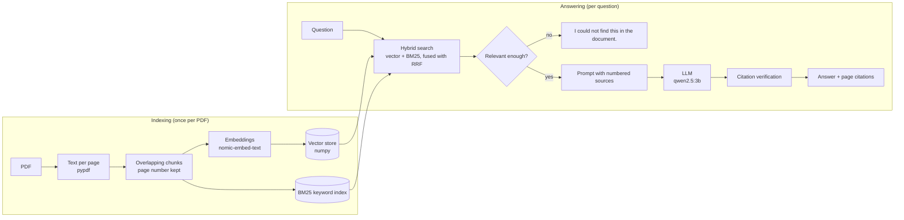

# RAG Pipeline: grounded Q&A over your PDFs

Upload a PDF, ask a question, and get a short answer that cites the exact page it came from. If the PDF does not contain the answer, the app says so instead of making something up.

Everything runs locally: models are served by [Ollama](https://ollama.com), so there are no API keys and no document ever leaves your machine. The pipeline is written from scratch in plain Python (`pypdf`, `numpy`, `requests`, `flask`) with no RAG framework, so every step is visible and easy to change.

**Results on the included evaluation set** (28 answerable + 6 out-of-scope questions, see [Evaluation](#evaluation)):

| Metric | Result |
|---|---|
| Correct chunk ranked first (hybrid search) | **82%** (vector only: 68%) |
| Correct chunk in top 3 | **93%** |
| Answers citing the source that contains the answer | **86%** (43% with the first prompt and no verification) |
| Out-of-scope questions correctly refused | **100%** (6 / 6) |
| Average answer time on a laptop CPU (`qwen2.5:3b`) | **~1.5 s** |

## How it works



1. **Load** (`rag/pdf_loader.py`): read the text of every page with `pypdf`, clean it up, and keep the page number.
2. **Chunk** (`rag/chunker.py`): group sentences into chunks of about 800 characters. Neighbouring chunks overlap by 150 characters so a fact on a boundary is never cut in half. Chunks never cross a page, so every citation points to one exact page.
3. **Embed** (`rag/embedder.py`): turn each chunk into a vector with `nomic-embed-text`, using its `search_document:` / `search_query:` prefixes.
4. **Store** (`rag/vector_store.py`): a small vector database in numpy. Vectors are normalised, so a single matrix product gives the cosine similarity to every chunk. The index is saved to disk and reloaded on restart.
5. **Retrieve** (`rag/retriever.py`, `rag/bm25.py`): run two searches.
   - *Vector search* finds chunks with the same **meaning** ("headlight" → "front light").
   - *BM25 keyword search*, implemented from scratch, finds **exact tokens** that embeddings blur, such as error codes (`E-21`), phone numbers and torque values.

   The two rankings are merged with **Reciprocal Rank Fusion**: each chunk scores `1 / (60 + rank)` from each list, so chunks that both methods like rise to the top.
6. **Guard** (`rag/pipeline.py`): if even the best chunk is barely similar to the question (cosine < 0.52), the question is off-topic and we answer "I could not find this in the document." without calling the LLM at all.
7. **Generate** (`rag/prompt.py`, `rag/llm.py`): the top 5 chunks are numbered `[1]`–`[5]` and the model is told to answer only from them, cite a number after every sentence, and refuse if the answer is not there. Temperature is 0.
8. **Verify citations** (`rag/citations.py`): small models often state the right fact but forget the citation or cite the wrong number. For each sentence we measure how many of its words appear in each source:
   - a correct citation is kept;
   - a wrong or missing citation is replaced with the source that actually supports the sentence;
   - a sentence that no source supports is flagged, and the answer is marked **not grounded** in the UI.

## Evaluation

`eval/questions.json` has 28 questions about a 6-page sample manual (`eval/sample_manual.pdf`). Each one is labelled with the phrase that proves the answer. There are also 6 questions the manual cannot answer. Run it with:

```bash
python eval/evaluate.py              # retrieval + answers (needs Ollama)
python eval/evaluate.py --retrieval  # retrieval only
```

**Retrieval** (chunk size 800):

| Search | hit@1 | hit@3 | hit@5 | MRR |
|---|---|---|---|---|
| Vector only | 68% | 93% | 96% | 0.79 |
| BM25 only | 75% | 89% | 93% | 0.83 |
| **Hybrid (RRF)** | **82%** | **93%** | 93% | **0.87** |

**Chunk size sweep** (MRR, overlap = 20% of chunk size):

| Chunk size | Vector | BM25 | Hybrid |
|---|---|---|---|
| 400 | 0.89 | 0.81 | 0.87 |
| 600 | 0.90 | 0.81 | 0.88 |
| 800 | 0.79 | 0.83 | 0.87 |
| 1200 | 0.85 | 0.79 | 0.88 |

Vector-only search swings between 0.79 and 0.90 depending on chunk size, while hybrid search stays at 0.87–0.88. That stability is the main reason the pipeline uses hybrid retrieval. The evaluation set is small, so treat these numbers as a sanity check rather than a benchmark.

**Answers**: 86% of answers cite the chunk that contains the answer, and 6 / 6 out-of-scope questions ("What is the price?", "Who is the CEO?", "What is the capital of France?") are refused. The first version (a single plain prompt, no verification step) cited the right source in only 43% of answers, mostly because the model left citations out. A chat-style prompt with a worked example and the sentence-level verification step raised that to 86%.

Failures are still visible. For example, the model answered "frame size M" for a 180 cm rider (the manual says L). That sentence matches no source, so the verifier marks the answer as not grounded instead of showing it as trustworthy.

## Run it

You need Python 3.10+ and [Ollama](https://ollama.com/download).

```bash
# 1. models (about 2.2 GB in total)
ollama pull nomic-embed-text
ollama pull qwen2.5:3b

# 2. code
git clone https://github.com/Jag2007/RAG-pipeline.git
cd RAG-pipeline
python3 -m venv .venv && source .venv/bin/activate
pip install -r requirements.txt

# 3. web app → http://localhost:5000
python app.py

# or ask from the terminal
python ask.py eval/sample_manual.pdf "What does error E-21 mean?"
```

Any setting in `rag/config.py` can be changed with an environment variable of the same name, for example `CHAT_MODEL=llama3.2:3b python app.py`.

## Deploy on Render

Render's free plan has 512 MB of memory, which is not enough to run local models. So the hosted version gets the two model jobs from APIs with free tiers: embeddings from [Jina AI](https://jina.ai) (`jina-embeddings-v3`, `rag/jina_embedder.py`) and answers from [Groq](https://groq.com) (`llama-3.3-70b-versatile`, `rag/groq_llm.py`). Everything else runs the same code as locally: chunking, BM25, rank fusion, the grounding guard and citation verification. Setting `GROQ_API_KEY` switches the provider automatically.

1. Get two free API keys: Groq at [console.groq.com/keys](https://console.groq.com/keys) and Jina at [jina.ai/api-dashboard](https://jina.ai/api-dashboard).
2. On [render.com](https://render.com): **New → Blueprint** → pick this repository. Render reads `render.yaml` and builds the `Dockerfile`.
3. Paste the keys into `GROQ_API_KEY` and `JINA_API_KEY` when asked → **Apply**.

Notes: the free instance sleeps after 15 minutes without visitors (the first request then takes about 30–50 s), and uploaded PDFs are cleared whenever it restarts.

To run the same container locally against Ollama:

```bash
docker build -t rag-pipeline .
docker run -p 5000:5000 -e OLLAMA_URL=http://host.docker.internal:11434 rag-pipeline
```

## Tests

```bash
pytest
```

The 36 unit tests swap the Ollama models for small fakes (`tests/fakes.py`), so they run offline in under a second. They cover chunking, BM25, the vector store, rank fusion, citation verification, the Groq and Jina request formats and the full pipeline, including refusals and saving/reloading the index.

## Project structure

```
rag/
  config.py        all settings in one place
  pdf_loader.py    PDF -> text per page
  chunker.py       pages -> overlapping chunks
  embedder.py      text -> vectors (Ollama)
  vector_store.py  numpy vector store with save/load
  bm25.py          keyword search from scratch
  retriever.py     hybrid search + reciprocal rank fusion
  prompt.py        grounded prompt with numbered sources
  llm.py           chat model (Ollama)
  jina_embedder.py embeddings through the Jina API, for hosting
  groq_llm.py      answers through the Groq API, for hosting
  citations.py     sentence-level citation verification
  pipeline.py      ties every step together
app.py             Flask API + web UI
ask.py             command-line interface
Dockerfile         container for hosting (gunicorn)
render.yaml        Render blueprint
static/            HTML, CSS and JS for the UI
eval/              sample PDF, labelled questions, evaluation script
tests/             unit tests
```

## API

| Method | Path | Body | Returns |
|---|---|---|---|
| `POST` | `/api/upload` | form field `file` (PDF) | `{source, pages, chunks}` |
| `POST` | `/api/ask` | `{"question": "..."}` | `{answer, sources[], cited[], grounded}` |
| `GET` | `/api/documents` | | `[{source, chunks}]` |
| `DELETE` | `/api/documents/<name>` | | `{ok}` |
| `GET` | `/api/health` | | whether Ollama and both models are available |

## Limitations and next steps

- Scanned PDFs have no text layer; adding OCR (for example Tesseract) would cover them.
- Tables are read as plain text, so answers about table cells can be weaker.
- The vector store does a full scan, which is fine up to tens of thousands of chunks. Beyond that, an approximate index such as FAISS or HNSW would be needed.
- Citation verification uses word overlap, so a correct paraphrase with very different wording can be flagged as unsupported. That errs on the side of caution.
- A reranker model (a cross-encoder) on the top 20 chunks would likely raise hit@1 further.
